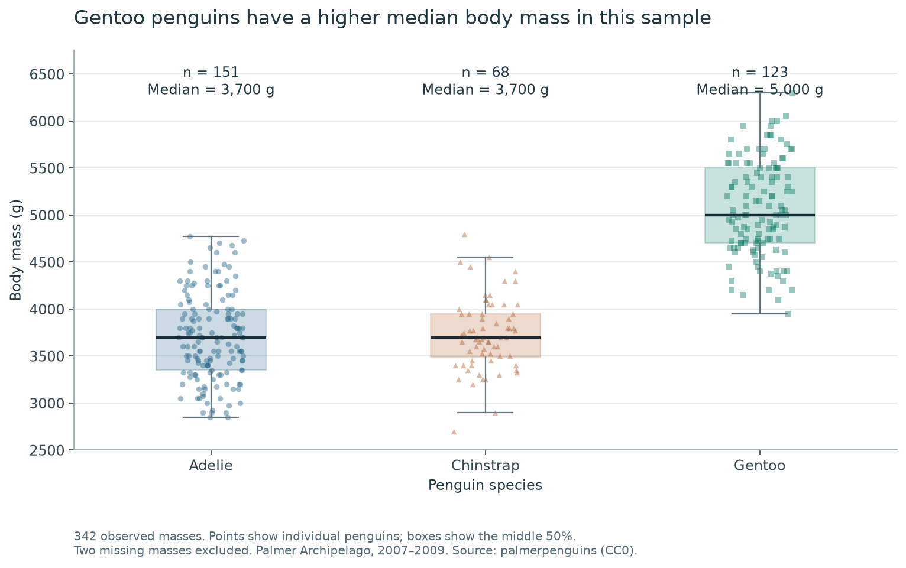
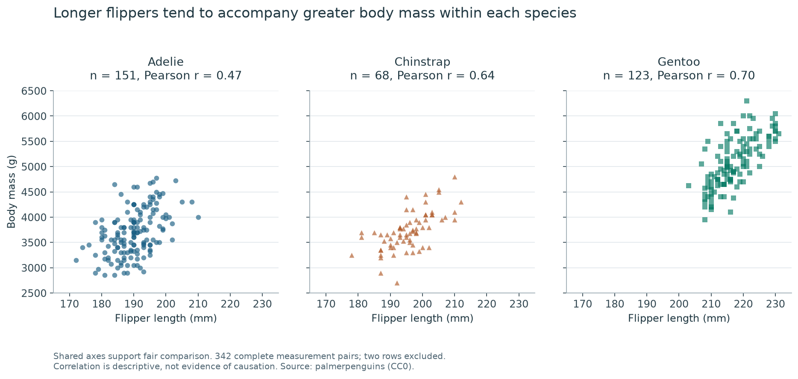

# Penguin size across species

A reproducible exploratory data-analysis project by **WEI ZIQIN**, prepared for
CISC7204 Practice 09. Analysis status: **completed**. Further analysis and
portfolio refinement remain possible.

## Research question

How does observed body mass differ among Adelie, Chinstrap and Gentoo penguins,
and how does the relationship between flipper length and body mass change when
each species is examined separately?

## Dataset source and usage permissions

The project uses the public, simplified **Palmer Penguins** dataset: 344
observed penguins, eight variables, three species, three islands and the years
2007–2009. The raw CSV is preserved unchanged in `penguins.csv`.

- [Official CSV](https://github.com/allisonhorst/palmerpenguins/blob/main/inst/extpenguins.csv)
- [Dataset documentation and explicit CC0 statement](https://allisonhorst.github.io/palmerpenguins/articles/intro.html)
- [CC0 terms](https://allisonhorst.github.io/palmerpenguins/LICENSE.html)

The documented CC0 permission allows this public redistribution and reuse.
The measurements concern penguins, not human subjects. No restricted course
datasets, student ID, personal contact details, credentials or API keys are
included. See [DATA_SOURCES.md](DATA_SOURCES.md) for attribution and research
references. `metrics.json` records a SHA-256 hash of the input file.

## Methods and tools

- Python, pandas and NumPy for data inspection, missing-value checks, group
  summaries and Pearson correlations.
- Matplotlib for two visualizations. The boxplot includes individual points,
  sample counts and medians. Scatterplot facets share both axes and use distinct
  colours and marker shapes for species.
- Built-in unittest checks source preservation, sample sizes and selected
  summary values. A fixed random seed controls horizontal point jitter.
- GitHub for versioned source and documentation. The companion portfolio is
  intended for GitHub Pages, with `main` and `/ (root)` as its publishing source.

Only rows missing measurements required by a specific analysis are excluded.
No measurement is imputed. Both analyses retain 342 records and exclude two.
Rows with a missing sex value are retained because sex is not used as a filter.
Box whiskers follow the standard 1.5-IQR rule; all individual observations are
still shown, including observations beyond the whiskers. The analysis is
descriptive: no causal effect or trained prediction model is claimed.

## Key findings

| Species | Observed masses | Median body mass (g) | Within-species Pearson r |
| --- | ---: | ---: | ---: |
| Adelie | 151 | 3,700 | 0.47 |
| Chinstrap | 68 | 3,700 | 0.64 |
| Gentoo | 123 | 5,000 | 0.70 |

Gentoo has a median body mass 1,300 g higher than each of the other two species
in this sample. Individual distributions overlap, so this is not a rule that
every Gentoo penguin is heavier than every other penguin.

The pooled flipper-length/body-mass correlation is approximately **0.87**.
The three within-species correlations are positive but lower, showing why a
pooled association should not be assumed to describe every subgroup equally.

### Visualization 1: body mass by species



### Visualization 2: flipper length and body mass within species



## Limitation and next improvement

These observations are restricted to three islands and 2007–2009. They are not
a random sample of all penguins, and species and island are not independently
balanced. Sex and other biological factors may contribute to within-species
variation. Missing observations could introduce selection bias, and correlation
does not establish causation. A next analysis would compare sex-specific
subgroups, report their sample sizes, and examine uncertainty before attempting
any predictive model.

## Running the analysis

Use Python 3.11 or newer; the recorded verification environment was Python
3.14.6 with NumPy 2.4.6, pandas 3.0.3 and Matplotlib 3.11.0. The requirements
file pins those package versions.

```bash
git clone https://github.com/crudeboywei-cyber/data-science-project.git
cd data-science-project
python -m venv .venv
```

Activate the environment on Windows PowerShell:

```powershell
.\.venv\Scripts\Activate.ps1
```

Or activate it on macOS/Linux:

```bash
source .venv/bin/activate
```

Then run:

```bash
python -m pip install -r requirements.txt
python analysis.py
python -m unittest -v
```

If PowerShell activation is disabled by local policy, use the environment's
Python executable directly; no system-wide policy change is required:

```powershell
.\.venv\Scripts\python.exe -m pip install -r requirements.txt
.\.venv\Scripts\python.exe analysis.py
.\.venv\Scripts\python.exe -m unittest -v
```

The script reads the included CSV and regenerates both PNG images,
`species_summary.csv` and `metrics.json`. No network access,
API key, absolute local file path or secret is needed once the repository is
downloaded. Exact PNG bytes can differ across rendering environments; the
statistics and deterministic jitter settings should remain consistent.

## Repository structure

```text
analysis.py             Reproducible analysis and both figures
test_analysis.py        Source-preservation and result checks
requirements.txt        Recorded dependency versions
penguins.csv            Unmodified public input data
DATA_SOURCES.md         Source, permission and attribution notes
*.png                   Two generated charts
species_summary.csv     Species-level descriptive statistics
metrics.json            Missingness, correlations and source SHA-256
```

## Assistance and authorship

AI assistance was used to prepare, debug and document the code and portfolio.
The measurements come from the cited public dataset and the displayed numbers
were computed by running `analysis.py`. This is a coursework learning project,
not a claim of professional ecological expertise or independent data collection.
